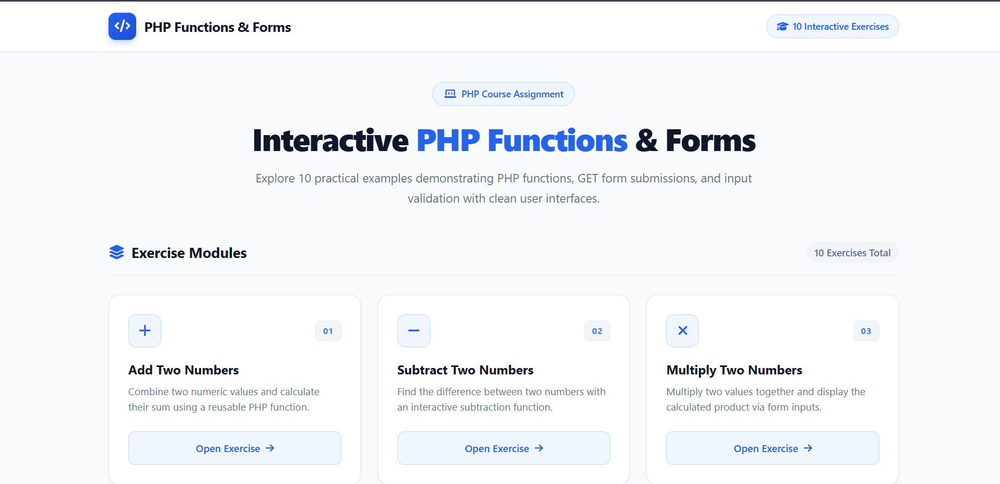
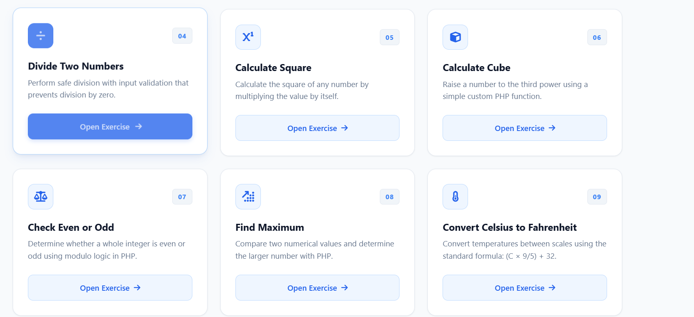
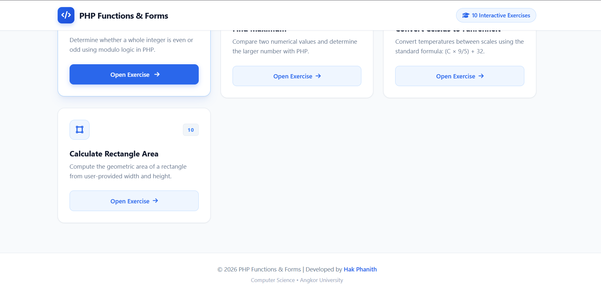

PHP Functions & Forms
<p align="center">
  <strong>PHP Functions & Forms — School Assignment Project</strong>
</p>
<p align="center">
  A collection of 10 interactive PHP exercises demonstrating functions, calculations, form handling, and input validation.
</p>
📌 Project Overview
This project is developed as a school assignment to practice PHP functions and HTML forms.
It contains 10 interactive exercises, each demonstrating a different programming concept using PHP.
## 📸 Project Preview





 ✨ Features
- 10 Interactive PHP Exercises
- Responsive User Interface
- HTML Forms for User Input
- PHP Functions and Calculations
- Input Validation
- Error Handling
- Clean and Modern Dashboard Design
📚 Exercises
| No. | Exercise | PHP File |
|---|---|---|
| 01 | Add Two Numbers | function01.php |
| 02 | Subtract Two Numbers | function02.php |
| 03 | Multiply Two Numbers | function03.php |
| 04 | Divide Two Numbers | function04.php |
| 05 | Calculate Square | function05.php |
| 06 | Calculate Cube | function06.php |
| 07 | Check Even or Odd | function07.php |
| 08 | Find Maximum | function08.php |
| 09 | Convert Celsius to Fahrenheit | function09.php |
| 10 | Calculate Rectangle Area | function10.php |

🛠️ Technologies Used

- HTML5
- CSS3
- PHP
- Apache (XAMPP)

🚀 Installation & Setup

1. Download or clone this repository.
2. Install XAMPP.
3. Copy the project folder into:

   `C:\xampp\htdocs\`

4. Start Apache in XAMPP Control Panel.
5. Open your browser and visit:

   `http://localhost/PHP_Functions_Forms/index.php`

📂 Project Structure

```text
PHP_Functions_Forms/
│
├── index.php
├── function01.php
├── function02.php
├── function03.php
├── function04.php
├── function05.php
├── function06.php
├── function07.php
├── function08.php
├── function09.php
├── function10.php
└── README.md
```

👨‍💻 Author

Hak Phanith

School Assignment Project  
PHP Functions & Forms

📄 License

This project is created for educational purposes.

<p align="center">
  © 2026 PHP Functions & Forms | Developed by Hak Phanith
</p>
